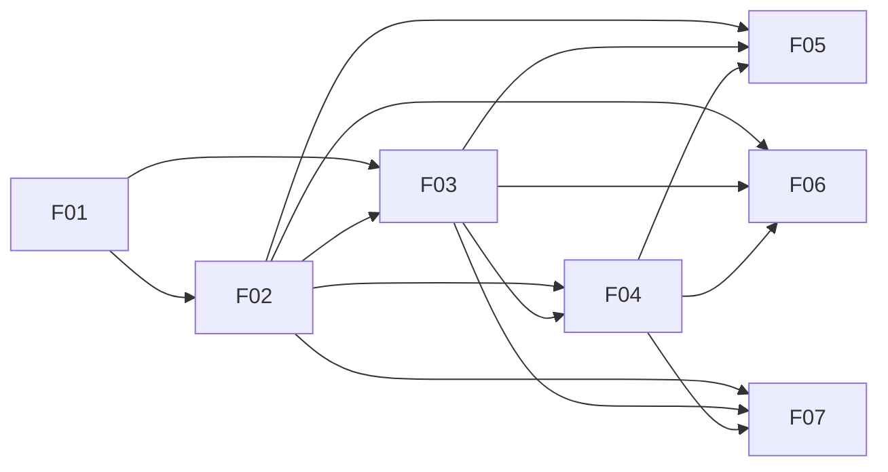

# PRD — Catraca MVP

Fonte: brief da fundadora em [`docs/enunciado.md`](enunciado.md) (regras R01–R13, gateway simulado, contrato fixo da API de parceiros). Design aprovado: [`docs/planning/design.md`](planning/design.md).

## 1. Visão

A Catraca vende ingressos para eventos pequenos (shows em bar, workshops, meetups). O MVP cobre o ciclo completo: o organizador cria e publica o evento, participantes e parceiros compram, o gateway confirma ou recusa, o organizador faz o check-in, acompanha o painel e pode cancelar o evento com estorno.

O risco central deste projeto é a integração. Cada feature aqui tem critérios próprios **e** critérios cross-feature (`XF-n`) que provam que o que uma feature provê chega e funciona na que consome.

## 2. Personas

| Persona | Acesso |
|---|---|
| Visitante | Sem login. Vê a vitrine. |
| Participante | Cria conta (nome, e-mail, senha), entra, sai, compra, vê "Meus ingressos". |
| Organizador | Conta vem da seed. Cria e opera os próprios eventos na área de organizador. |
| Parceiro | Sistema externo. Usa a API de parceiros com `X-Api-Key`. |

## 3. Status do ingresso

| Rótulo (UI) | Valor (API) | Quando |
|---|---|---|
| pendente | `pending` | compra criada, aguardando gateway |
| confirmado | `confirmed` | gateway aprovou |
| recusado | `declined` | gateway recusou |
| cancelado | `cancelled` | estava pendente quando o evento foi cancelado |
| estornado | `refunded` | estava confirmado quando o evento foi cancelado |

Check-in não é status: campo `checkedIn` à parte.

## 4. Features

### F01 — Fundação (harness, contas e acesso)
Harness (subir, derrubar, gates), docker compose, banco com schema completo, seed, cadastro/login/logout de participante, login de organizador, guarda de acesso por papel.

- **Provê:** comandos `./scripts/up.sh`, `./scripts/down.sh`, `./scripts/gates.sh`; schema `users`/`events`/`tickets`; seed (organizador A, organizador B, participante); `current_user`, `require_user`, `require_organizer`; layout base dos templates; infraestrutura de testes.
- **Consome:** nada.

### F02 — Eventos do organizador
Criação, edição, publicação, página de gestão com URL própria, isolamento entre organizadores, cálculo de vagas.

- **Provê:** `get_event`, `get_owned_event`, `list_on_sale`; `occupied_seats`, `available_seats`; página de gestão `/org/events/{id}` com pontos de inclusão para check-in, cancelamento e painel.
- **Consome:** F01 (schema, sessão, `require_organizer`, layout).

### F03 — Vitrine e compra
Vitrine pública, página do evento com compra, serviço de compra com lock de lotação, gateway simulado assíncrono, "Meus ingressos".

- **Provê:** `purchase(...)` com exceções `InvalidRequest`/`EventNotAvailable`/`SoldOut`; gateway (`decide`, `schedule`, `apply_result`, `reschedule_pending`); ingressos com código único e preço gravado.
- **Consome:** F01 (sessão, `require_user`, schema), F02 (`list_on_sale`, `get_event`, `available_seats`, `occupied_seats`).

### F04 — API de parceiros
As três rotas do contrato fixo, autenticação por `X-Api-Key`, ordem de validação de erros.

- **Provê:** canal de venda externo; consulta de ingresso de qualquer canal (`GET /api/partner/tickets/{id}`).
- **Consome:** F02 (`list_on_sale`, `available_seats`), F03 (`purchase`, ingressos).

### F05 — Check-in
Campo de check-in na página de gestão e as cinco mensagens de R10 na ordem.

- **Provê:** marcação `checked_in` do ingresso.
- **Consome:** F02 (página de gestão, `get_owned_event`), F03 (ingressos e status), F04 (ingressos vendidos pela API e consulta `checkedIn`).

### F06 — Cancelamento de evento
Cancelamento irreversível, estorno/cancelamento dos ingressos, bloqueio de edição e republicação, imunidade a resposta tardia do gateway.

- **Provê:** evento em estado `cancelled` e transições `confirmed→refunded`, `pending→cancelled`.
- **Consome:** F02 (página de gestão, edição/publicação, `list_on_sale`), F03 (ingressos, gateway `apply_result`), F04 (compras e consultas pela API).

### F07 — Painel do evento
Seção do painel na página de gestão com os seis números de R12.

- **Provê:** visão consolidada de vendas do evento.
- **Consome:** F02 (página de gestão, `available_seats`), F03 (ingressos da vitrine com preço gravado), F04 (ingressos da API).

## 5. Grafo de dependências

Arestas (provedor → consumidor): F01→F02, F01→F03, F02→F03, F02→F04, F03→F04, F02→F05, F03→F05, F04→F05, F02→F06, F03→F06, F04→F06, F02→F07, F03→F07, F04→F07.

## 6. Waves

| Wave | Features | Execução |
|---|---|---|
| W1 | F01 | sequencial |
| W2 | F02 | sequencial |
| W3 | F03 | sequencial |
| W4 | F04 | sequencial |
| **W5** | **F05, F06, F07** | **paralela** — três branches em worktrees, ao mesmo tempo, integradas por PRs |

F05, F06 e F07 não dependem entre si: os status `cancelled`/`refunded` e a coluna `checked_in` já existem no schema de F01, então cada uma testa seu comportamento preparando o estado direto no banco. A interação entre elas é verificada na main pelo Fluxo do avaliador (seção 9).

## 7. Critérios de aceite por feature

### F01
- **F01-AC-1:** Em clone limpo, `./scripts/up.sh` deixa o produto acessível em `http://localhost:8000` com a seed carregada, sem nenhum outro passo, e sem nenhuma chave de pagamento (gateway simulado).
- **F01-AC-2:** `./scripts/down.sh` encerra tudo que a subida iniciou: a porta 8000 não responde e nenhum container do projeto aparece em `docker ps`. Subir de novo funciona sem erro, inclusive a seed.
- **F01-AC-3:** `./scripts/gates.sh` roda lint e testes automatizados e termina com código 0.
- **F01-AC-4:** A seed cria organizador A, organizador B e participante; rodar a seed de novo não gera erro nem duplica contas; as três credenciais entram.
- **F01-AC-5:** O participante cria conta com nome, e-mail e senha, entra e sai. E-mail repetido e senha errada são rejeitados.
- **F01-AC-6 (R13):** Visitante e participante não acessam a área de organizador (`/org/...`): visitante é levado ao login, participante recebe 403. Organizador acessa.
- **F01-AC-7:** `AGENTS.md` na raiz traz os comandos de subir, derrubar e gates e o mapa dos artefatos; `CLAUDE.md` aponta para ele.

### F02
- **F02-AC-1 (R01):** Organizador cria evento com nome, data e hora de início, local, lotação inteira ≥ 1 e preço em reais > 0. Lotação 0 e preço 0 são rejeitados.
- **F02-AC-2 (R01):** Data de início no passado é rejeitada ao criar e ao editar.
- **F02-AC-3 (R02):** Evento nasce rascunho e não aparece em `list_on_sale`; depois de publicado, aparece.
- **F02-AC-4 (R03, R05):** Reduzir a lotação abaixo das vagas ocupadas (pendentes + confirmados) é rejeitado; aumentar é aceito.
- **F02-AC-5 (R04):** Cada evento tem página de gestão com URL própria (`/org/events/{id}`), onde o organizador edita e publica.
- **F02-AC-6 (R13):** A lista da área de organizador mostra só os eventos do organizador logado; GET ou POST na página de gestão de evento de outro organizador responde 404 sem nenhum dado do evento.
- **F02-AC-7 (R05):** `available_seats` = lotação − (pendentes + confirmados); em evento cancelado, 0.

### F03
- **F03-AC-1 (R02):** A vitrine mostra só eventos publicados e não cancelados.
- **F03-AC-2 (R06, R09):** A compra na vitrine responde sem esperar o gateway, com o ingresso pendente; "Meus ingressos" mostra evento, status (rótulo) e código de cada ingresso do participante.
- **F03-AC-3 (R08):** Cartão final 0001 confirma em até 5 s; final 0002 recusa e libera a vaga; finais 0003/0004 respondem entre 30 e 40 s; outro final recusa em 2–5 s.
- **F03-AC-4:** Cartão sem 16 dígitos é rejeitado antes de criar o ingresso.
- **F03-AC-5 (R05, R06):** Ingresso pendente ocupa vaga até a resposta do gateway.
- **F03-AC-6 (R07):** Sem vaga, a vitrine exibe `Ingressos esgotados` (no lugar da compra ou como resposta à tentativa) e não cria ingresso.
- **F03-AC-7 (R07):** Compras simultâneas no serviço nunca deixam vagas ocupadas acima da lotação.
- **F03-AC-8 (R09):** Cada ingresso tem código único.
- **F03-AC-9 (R03):** O preço é gravado no ingresso no momento da compra; mudança de preço posterior não altera ingressos existentes.
- **F03-AC-10 (R08):** Após reinício da aplicação, ingressos pendentes são resolvidos pelo gateway (os vencidos imediatamente, os demais no prazo).

### F04
- **F04-AC-1:** Sem `X-Api-Key` ou com chave inválida, as três rotas respondem 401 `{"error":"unauthorized"}`.
- **F04-AC-2 (R02, R05):** `GET /api/partner/events` lista só eventos publicados e não cancelados, com `id`, `name`, `startsAt`, `priceCents`, `availableSeats`.
- **F04-AC-3 (R06):** `POST /api/partner/events/{id}/purchases` válido responde 202 `{ticketId, code, status:"pending"}`.
- **F04-AC-4:** Erros da compra na ordem: 422 `invalid_request` (campo faltando, e-mail mal formado, cartão sem 16 dígitos), 404 `event_not_available` (inexistente, rascunho, cancelado), 409 `sold_out`.
- **F04-AC-5 (R07):** Em duas ou mais rodadas, cada uma em evento novo de lotação 5, 30 compras simultâneas resultam em exatamente 5×202 e 25×409.
- **F04-AC-6:** `GET /api/partner/tickets/{id}` responde 200 `{ticketId, code, eventId, status, checkedIn}`; inexistente responde 404 `ticket_not_found`.
- **F04-AC-7 (R08):** Compra pela API com cartão final 0004 fica `declined` após a resposta do gateway e a vaga volta a `availableSeats`.

### F05
- **F05-AC-1 (R10):** Código inexistente → `Ingresso inválido para este evento`.
- **F05-AC-2 (R10):** Evento cancelado com código do próprio evento → `Evento cancelado` (ou a mensagem no lugar do campo).
- **F05-AC-3 (R10):** Ingresso não confirmado (pendente, recusado, cancelado, estornado) → `Ingresso não confirmado`.
- **F05-AC-4 (R10):** Segundo check-in do mesmo ingresso → `Ingresso já utilizado`.
- **F05-AC-5 (R10):** Ingresso confirmado sem check-in → `Entrada liberada` e o ingresso fica com check-in.
- **F05-AC-6 (R10):** A ordem da lista vale: código de outro evento resulta em `Ingresso inválido para este evento` mesmo com evento cancelado.

### F06
- **F06-AC-1 (R11):** O organizador cancela evento publicado; rascunho não pode ser cancelado; o cancelamento é irreversível.
- **F06-AC-2 (R11):** Evento cancelado sai de `list_on_sale` e não aceita compras.
- **F06-AC-3 (R11):** Em até 10 s do cancelamento, confirmados ficam estornados e pendentes ficam cancelados.
- **F06-AC-4 (R11):** Resposta do gateway que chega depois do cancelamento não muda o status do ingresso.
- **F06-AC-5 (R11):** Evento cancelado não pode ser editado nem republicado (página sem formulário; POST direto rejeitado).
- **F06-AC-6 (R13):** Organizador não cancela evento de outro (404 sem dados).

### F07
- **F07-AC-1 (R12):** O painel mostra Confirmados (inclui os com check-in), Pendentes, Check-ins (confirmados com check-in), Vagas disponíveis (R05), Receita e Estornados.
- **F07-AC-2 (R12, R03):** Receita = soma de `price_cents` dos ingressos confirmados, cada um com o preço vigente na sua compra, formatada `R$ 350,00`.
- **F07-AC-3 (R12):** Recusados, cancelados e estornados não entram na receita; estornados aparecem em Estornados.
- **F07-AC-4 (R12, R05):** Em evento cancelado, Vagas disponíveis mostra 0.

## 8. Critérios cross-feature

Cada aresta do grafo tem pelo menos um critério. A coluna "Contrato" indica a feature cujo contrato cobre o critério.

| ID | Aresta | Critério | Regras | Contrato |
|---|---|---|---|---|
| XF-1 | F01→F02 | Organizador A da seed entra e acessa `/org/events`; o participante da seed recebe 403 na mesma rota. | R13 | F02 |
| XF-2 | F01→F03 | Participante criado por `/signup` compra na vitrine e vê o ingresso em "Meus ingressos"; visitante que tenta comprar é levado ao login. | R06, R09 | F03 |
| XF-3 | F02→F03 | Evento criado e publicado na área de organizador aparece na vitrine, rascunho não; após o organizador mudar o preço, a compra seguinte grava o preço novo e a anterior mantém o antigo; reduzir a lotação abaixo dos ingressos comprados na vitrine é rejeitado. | R02, R03, R05 | F03 |
| XF-4 | F02→F04 | Rascunho fica fora de `GET /api/partner/events`; publicado aparece com `availableSeats` = lotação e `priceCents` = preço em centavos. | R02, R05 | F04 |
| XF-5 | F03→F04 | Compras pela API ocupam vagas vistas pela vitrine (esgotado pela API ⇒ vitrine exibe `Ingressos esgotados`); ingresso comprado na vitrine é consultável em `GET /api/partner/tickets/{id}`. | R05, R07, R09 | F04 |
| XF-6 | F02→F05 | O check-in fica na página de gestão do evento; organizador B não faz check-in em evento de A (404). | R04, R10, R13 | F05 |
| XF-7 | F03→F05 | Ingresso da vitrine confirmado → `Entrada liberada`; pendente → `Ingresso não confirmado`; código de ingresso de outro evento → `Ingresso inválido para este evento`. | R09, R10 | F05 |
| XF-8 | F04→F05 | Ingresso comprado pela API passa pelo check-in e `GET /api/partner/tickets/{id}` passa a mostrar `checkedIn: true`. | R10 | F05 |
| XF-9 | F02→F06 | Após cancelar, a página de gestão não oferece edição/publicação, POST de edição e de publicação são rejeitados, e o evento some de `list_on_sale`. | R04, R11 | F06 |
| XF-10 | F03→F06 | Após cancelar, a vitrine não mostra nem vende o evento, e "Meus ingressos" mostra o ingresso confirmado como `estornado` e o pendente como `cancelado`. | R09, R11 | F06 |
| XF-11 | F04→F06 | Após cancelar, compra pela API responde 404 `event_not_available`; ingressos da API ficam `refunded`/`cancelled` em até 10 s e um pendente com cartão 0003 continua `cancelled` depois da resposta do gateway. | R11 | F06 |
| XF-12 | F02→F07 | O painel aparece na página de gestão do evento; aumentar a lotação reflete em Vagas disponíveis; organizador B não vê o painel de A. | R03, R04, R12, R13 | F07 |
| XF-13 | F03→F07 | Compras da vitrine contam no painel; após mudança de preço, Receita soma cada ingresso confirmado pelo preço da sua compra. | R03, R12 | F07 |
| XF-14 | F04→F07 | Compras pela API contam em Confirmados, Pendentes e Vagas disponíveis do painel exatamente como as da vitrine. | R05, R12 | F07 |

## 9. Verificação de integração na main

Interações entre features da mesma wave paralela (F05×F06, F06×F07, F05×F07) não são arestas do grafo; são verificadas ao final, na main, a partir de clone limpo, pelo Fluxo do avaliador do enunciado (passos 1–17), em especial:

- passo 14: check-in em evento cancelado → `Evento cancelado`; painel com Estornados 1 e Receita R$ 0,00 (F05+F06+F07);
- passo 10: Check-ins 1 no painel depois do check-in (F05+F07).

## 10. Rastreabilidade R01–R13

| Regra | Critérios |
|---|---|
| R01 | F02-AC-1, F02-AC-2 |
| R02 | F02-AC-3, F03-AC-1, F04-AC-2, XF-3, XF-4 |
| R03 | F02-AC-4, F03-AC-9, F07-AC-2, XF-3, XF-12, XF-13 |
| R04 | F02-AC-5, XF-6, XF-9, XF-12 |
| R05 | F02-AC-4, F02-AC-7, F03-AC-5, F04-AC-2, F07-AC-4, XF-3, XF-4, XF-5, XF-14 |
| R06 | F03-AC-2, F03-AC-5, F04-AC-3, XF-2 |
| R07 | F03-AC-6, F03-AC-7, F04-AC-5, XF-5 |
| R08 | F03-AC-3, F03-AC-10, F04-AC-7 |
| R09 | F03-AC-2, F03-AC-8, XF-2, XF-5, XF-7, XF-10 |
| R10 | F05-AC-1..6, XF-6, XF-7, XF-8 |
| R11 | F06-AC-1..5, XF-9, XF-10, XF-11 |
| R12 | F07-AC-1..4, XF-12, XF-13, XF-14 |
| R13 | F01-AC-6, F02-AC-6, F06-AC-6, XF-1, XF-6, XF-12 |

## 11. Fora de escopo

- Deploy e qualquer ambiente além do local.
- Gateway de pagamento real, e-mail e notificações.
- App mobile e qualidade visual: nenhum critério avalia design.
- Cadastro de organizador pelo produto.
- Mais de um ingresso por compra, mapa de assentos, cancelamento ou transferência de ingresso pelo participante.
- Atualização em tempo real: recarregar a página para ver o status novo basta.
- Fuso horário: fuso fixo `-03:00`; o fluxo só usa datas com pelo menos um dia de folga.
